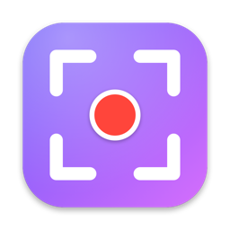
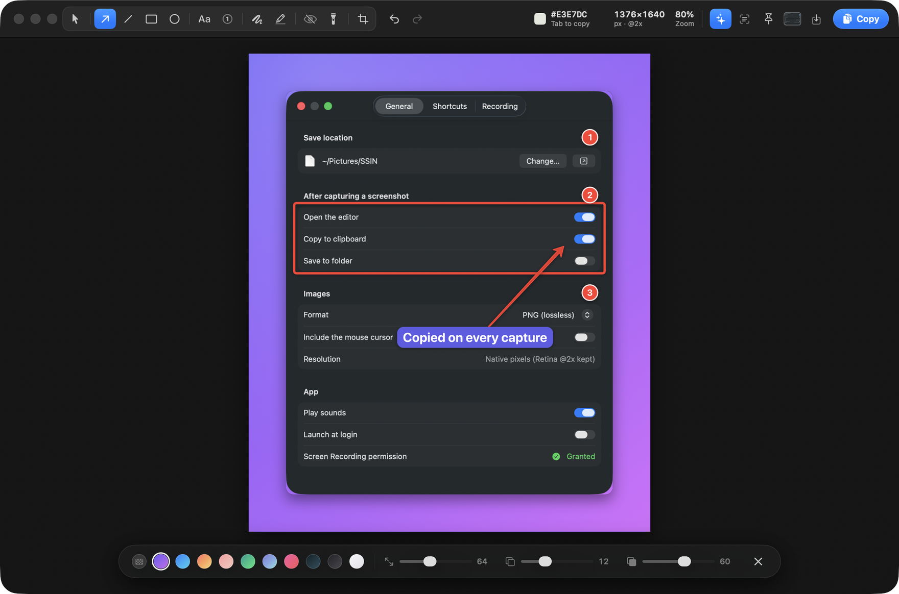

<p align="center">
  
</p>

<h1 align="center">SSIN</h1>

<p align="center">
  <b>Lightweight by design.</b> Native macOS screenshots and screen recording, with an editor that's quick to use and good-looking.<br>
  <sub>~3 MB app · ~13 MB RAM idle · zero dependencies · 100% Swift</sub>
</p>

<p align="center">
  
</p>

## Features

- **Capture.** Grab an area, a window or the full screen at native Retina resolution. The screen freezes the moment you hit the hotkey, so menus and tooltips stay in the shot.
- **Edit.** Arrows, shapes, text, numbered steps, pen, highlighter, blur or pixelate, spotlight, crop, and one-click gradient backgrounds.
- **Share.** Copy, save, drag into any app, or pin the image on top of everything. Copy and Save close the editor; hold ⌥ to keep it open.
- **OCR.** Copy the text from any part of the screen.
- **Record.** Save the screen as MP4 (H.264 or HEVC, 30 or 60 fps), with click highlights, then trim it right away. Turn the microphone and desktop audio on or off right on the recording overlay (click them, or press <kbd>M</kbd> / <kbd>D</kbd>); the recording bar shows which ones are live.
- **Stays out of the way.** SSIN lives in the menu bar, starts at login, and every shortcut can be changed.

| Shortcut | Action |
|---|---|
| <kbd>⇧⌘1</kbd> | Capture full screen |
| <kbd>⇧⌘2</kbd> | Capture area / window |
| <kbd>⇧⌘6</kbd> | Start / stop recording |
| <kbd>⇧⌘7</kbd> | Capture text (OCR) |

## Install

You need macOS 15 or later and the Command Line Tools (`xcode-select --install`). Xcode itself isn't required.

```bash
git clone https://github.com/nikkoenggaliano/ssin.git && cd ssin
scripts/setup-signing.sh          # once: creates a local code-signing certificate
scripts/build-app.sh --install    # builds, copies to /Applications and launches
```

When macOS asks, allow SSIN under **Screen & System Audio Recording**, then click **Quit & Reopen**. That's the only permission SSIN needs. Microphone access is only requested if you record your voice.

> [!NOTE]
> macOS ties the Screen Recording permission to the app's code signature. Signing with the same local certificate every time means you grant the permission once and it survives rebuilds.

If something doesn't work, run `scripts/doctor.sh`. It checks the signature, the login item, duplicate copies and apps that grab the same shortcuts.

<details>
<summary><b>Uninstall</b></summary>

```bash
pkill -x SSIN; rm -rf /Applications/SSIN.app
defaults delete dev.ssin.app; tccutil reset All dev.ssin.app
security delete-identity -c "SSIN Local Signing"
```
</details>

<details>
<summary><b>Development</b></summary>

```bash
swift build
.build/debug/SSIN --interaction-test path/to/any-screenshot.png   # editor test suite
```

Debug builds also have `--editor-snapshot`, `--capture-test`, `--record-test` and `--perf-test`. See `Sources/SSIN/Debug/DebugCommands.swift`.
</details>

## License

[MIT](LICENSE)
